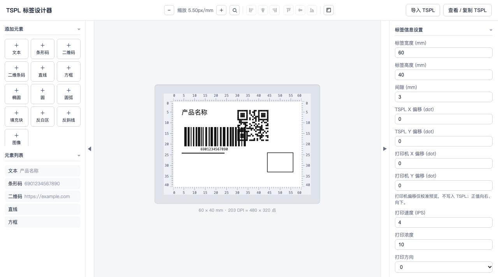
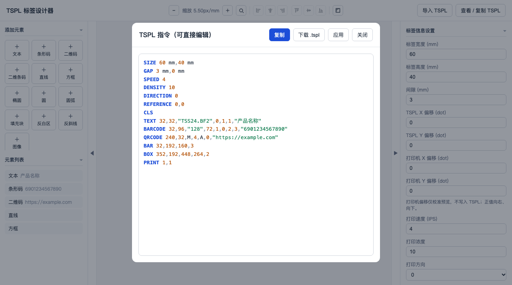

# TSPL 标签可视化设计器

一个纯前端的 TSPL（TSC 打印机指令语言）标签设计器。支持可视化拖拽设计、实时预览，以及 TSPL 指令的导出与导入。不依赖打印机连接。

## 界面预览

**标签设计画布**：添加元素、调整标签参数并实时预览。



**TSPL 指令编辑器**：查看、编辑、复制或下载生成的打印指令。



## 功能

- **可视化画布**：按真实物理尺寸（203 DPI，mm ↔ 点换算）预览标签，支持鼠标拖拽移动元素
- **元素多选**：在画布或左侧元素列表中按住 Cmd（macOS）/Ctrl（Windows）点击，可追加或取消选择；普通点击单选，多选后可使用对齐工具，按 Delete/Backspace 可一次删除选中元素
- **编辑快捷键**：Cmd/Ctrl+A 全选画布元素；选中元素后按 Cmd/Ctrl+C 复制，Cmd/Ctrl+V 粘贴（每次向右下偏移 2 mm）；Cmd/Ctrl+Z 撤销，Cmd/Ctrl+Shift+Z 或 Ctrl+Y 重做。输入框与弹窗保持原有键盘操作
- **适应画布**：点击画布右上角的图标，按当前视口、标尺和标签尺寸将画布放大或缩小到完整可见的最大尺寸
- **新建空白**：清空画布元素并恢复默认标签参数；可通过撤销恢复原设计
- **撤销与重做**：工具栏记录最近 30 次标签、元素和变量编辑；一次拖动算一次操作
- **十三类元素**：文本、条形码、二维码、二维条码（PDF417/DataMatrix/Aztec/MaxiCode）、直线、方框、椭圆、圆、圆弧、填充块、反白区、反斜线、图像（BMP/PCX 占位）
- **属性编辑**：坐标、字体、码制、放大倍数、旋转角度等
- **标签信息设置**：标签宽高、间隙、打印速度、浓度、方向、份数（可折叠）
- **导出 TSPL**：一键查看、复制、下载 `.tspl` 指令文件
- **导入 TSPL**：粘贴现有指令，还原标签与元素
- **变量管理**：定义 `%name%`、`##name##`、`#%name#%` 等自选包围符号的占位符（两侧符号相同，名称以字母或下划线开头），并设置必填预览值；在文本、条码、二维码和二维条码内容中插入变量。画布用预览值显示，导出的 `.tspl` 原样保留占位符，供业务程序替换真实数据。变量定义保存在当前浏览器本地，导出的 TSPL 文件不包含预览值。

## 快速开始

```bash
npm install
npm run dev
```

构建产物：

```bash
npm run build   # 输出到 dist/
npm run preview # 预览构建产物
```

## 项目结构

```
src/
  main.tsx                  # 入口
  App.tsx                   # 主组件，状态管理
  types.ts                  # 元素与标签类型定义
  defaults.ts               # 默认标签/元素
  index.css                 # 全局样式
  lib/
    units.ts                # mm ↔ 点(dot) 换算
    fonts.ts                # 字体表 / 码制 / 旋转角度常量
    tspl.ts                 # 元素 → TSPL 指令生成 + 包围盒估算
    parse.ts                # TSPL 指令 → 元素解析
    tsplSyntax.ts           # TSPL 指令清单 + 语法高亮
    id.ts                   # 元素 ID 生成
  components/
    Canvas.tsx              # 画布（拖拽 + 缩放）
    ElementRenderer.tsx     # 单个元素渲染
    ElementLibrary.tsx      # 左侧元素库
    LabelInfoPanel.tsx      # 右侧「标签信息设置」
    ElementPropsPanel.tsx   # 右侧「元素属性设置」
    TsplModal.tsx           # 导出弹窗
    TsplEditor.tsx          # TSPL 代码编辑器（语法高亮 + 标签补全）
    ImportModal.tsx         # 导入弹窗
    ui.tsx                  # 基础 UI 组件
    preview.ts              # 条码/二维码 SVG 编码
```

## 单位约定

TSPL 中不同字段单位不同，本项目已统一处理：

| 字段 | 单位 |
| --- | --- |
| `SIZE` / `GAP` | mm |
| `TEXT` / `BARCODE` / `QRCODE` 坐标 | 点 (dot) |
| 条码高度、`BAR` / `BOX` 尺寸 | 点 (dot) |
| `SPEED` / `DENSITY` / `DIRECTION` | 无单位数值 |

## 内置字体

内置 0–5：中文方格不变，纯英数宽高均为对应中文的一半；同一段文本中英混排时，英数保持表中的半宽，字高与中文一致。`.BF2` 为中文点阵（半角/全角）：

| 字体 | 中文 | 英数 | 说明 |
| --- | --- | --- | --- |
| 0 | 8×8 | 4×4 | 英数半尺寸 |
| 1 | 16×16 | 8×8 | 英数半尺寸 |
| 2 | 20×20 | 10×10 | 英数半尺寸 |
| 3 | 24×24 | 12×12 | 英数半尺寸 |
| 4 | 30×30 | 15×15 | 英数半尺寸 |
| 5 | 38×38 | 19×19 | 英数半尺寸 |
| TSS24.BF2 | 24×24 | 12×24 | 简体中文（GB 码） |
| TST24.BF2 | 24×24 | 12×24 | 繁体中文（Big5 码） |
| Arial | — | — | TTF 矢量 |

字体下拉框末尾可「＋ 添加自定义字体」，自定义字体名持久化到本地；点阵未知的自定义字体按 TTF 等比估算预览。

## 说明

- 画布条码、二维码和二维条码使用 bwip-js 编码为可扫码的 SVG；无效内容显示“数据无效”。预览沿用画布尺寸，实际打印精度以打印机渲染为准；缩放过小或留白不足时可放大画布再扫码。
- 支持导入的指令：`SIZE` / `GAP` / `SPEED` / `DENSITY` / `DIRECTION` / `PRINT` / `TEXT` / `BARCODE` / `QRCODE` / `BAR` / `BOX` / `ELLIPSE` / `CIRCLE` / `ARC` / `BLOCK` / `REVERSE` / `DIAGONAL` / `PUTBMP` / `PUTPCX` / `PDF417` / `DMATRIX` / `AZTEC` / `MAXICODE`，其余指令导入时会提示跳过

## 技术栈

TypeScript · React 18 · Vite
